# Muziekbox - bouwhandleiding

Een oplaadbare muziekbox die de kinderen zelf bedienen: een NFC-kaart tegen de box houden start een Spotify-playlist, vijf knoppen regelen volume, vorige, play/pauze en volgende, en met een zesde knop zetten ze de box aan. Wij beheren de box via de webpagina op de telefoon. De software is onze eigen versie van Phoniebox op GitHub (WNijhof/RPi-Jukebox-RFID, branch eigen/main).

De behuizing is een speels ovaal van 15 × 13,6 × 9,5 cm, met een afgeronde bovenrand, de knoppen in een boog en een pilvormig NFC-vlak.

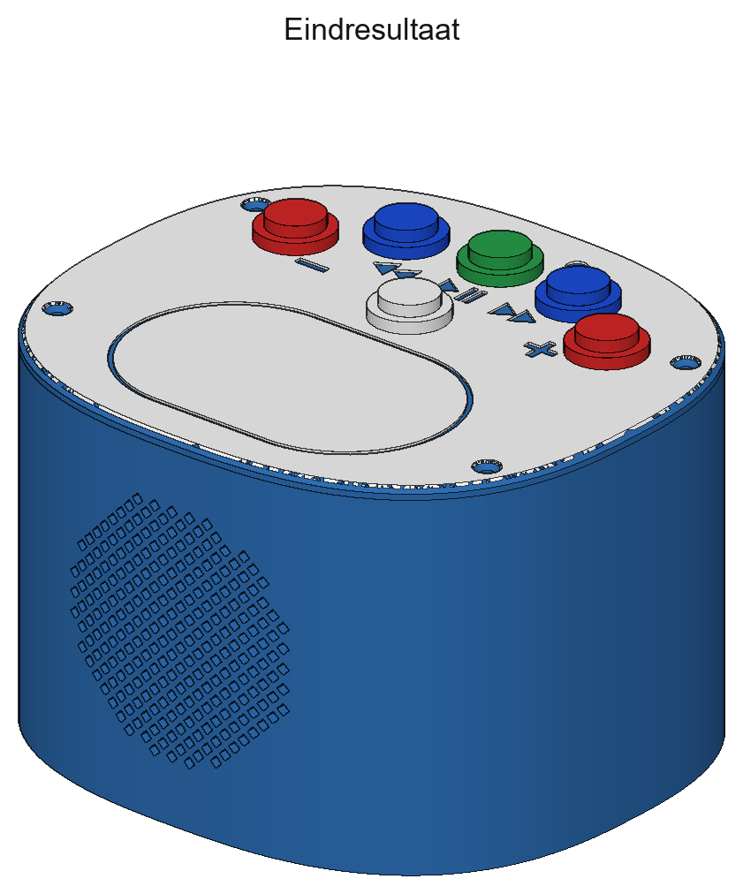

## 1. Onderdelen

### 1.1 Elektronica

| Aantal | Onderdeel | Gebruik |
|---|---|---|
| 1 | Raspberry Pi 3B | De computer van de box |
| 1 | MicroSD-kaart 32 GB (A1) | Software |
| 1 | PiSugar 3 Plus (accu 5000 mAh, USB-C) | Accu, laden en aan/uit |
| 1 | USB-C-lader 5 V / 3 A | Accu laden |
| 1 | RC522 RFID-lezer (13,56 MHz, SPI) | NFC-lezer |
| 1 | MAX98357A I2S-versterker (Adafruit-model, met pinheader) | Versterker |
| 1 | Speaker 4 Ω, 15 W, 75 mm (frame 79 × 79 mm, gaten 4 mm) | Geluid |
| 6 | Drukknop, terugverend, paneelgat 16 mm met 2 vlakke kanten (14,8 mm), 2 soldeerlippen | Bediening (5) en aanzetten (1) |
| 1 | LED 5 mm (groen) | Statuslampje |
| 5 | Weerstand 1 kΩ | In de draad van elke knop |
| 1 | Weerstand 330 Ω | Voor de LED |
| ± 25 | DuPont-draadjes female-female, 20 cm | Bedrading naar de Pi |
| 1 | Stukje gaatjesprint (± 5 × 7 cm) | GND-rail |
| 6 | Draadinzetstukken M3 | In de geprinte behuizing (deksel en kooibeugel) |

### 1.2 NFC-kaarten

Gebruik alleen Mifare Classic 1K (S50) kaarten of stickers, bijvoorbeeld de CUID-kaarten of stickers met aanpasbare UID. De RC522 leest geen NTAG-kaarten (zoals NTAG213/215). Plak stickers op een stevig kartonnetje met een plaatje van de playlist.

### 1.3 Boutjes, gereedschap en materiaal

- Boutjes: 4× M3 × 8 mm verzonken (deksel), 2× M3 × 6 mm (kooibeugel), 4× M4 × 10 mm met moer (speaker). De PiSugar wordt geleverd met afstandsbusjes en schroefjes voor de Pi zelf.
- Gereedschap: soldeerbout met tin, krimpkous, kniptang, striptang, kleine schroevendraaiers, een paperclip voor de aan/uit-knop.
- Filament: PETG of PLA, ongeveer 300 gram.

## 2. Zo werkt het

- De Raspberry Pi draait Phoniebox met onze Spotify-uitbreiding. De box verschijnt in Spotify als luidspreker "Muziekbox".
- Een kaart tegen het NFC-vlak: de box laat Spotify de bijbehorende (gedeelde) playlist afspelen.
- De knoppen bedienen Spotify. De volumeknoppen houden zich aan het ingestelde maximumvolume.
- De PiSugar-accu voedt alles en laadt via USB-C, ook terwijl de box speelt. Het batterijniveau staat in de webpagina. Zit de lader erin, dan blijft de box aan en knippert de status-LED; brandt de LED weer continu, dan is de accu vol. Knippert de LED snel, dan is de accu bijna leeg (onder 10 %). Bij 7 % klinkt een waarschuwingsgeluid, kort voordat de box uitgaat. Op de webpagina staat bij Settings per lading hoe lang de box aanstond en hoeveel muziek er speelde.
- Aanzetten doen de kinderen zelf met de witte aan-knop midden op het deksel. Die is parallel geschakeld aan de aan/uit-knop van de PiSugar; als de box aan staat, doet hij niets. Ook achterin zit een gaatje van 2,5 mm waarmee je met een paperclip via een geprint stiftje op de PiSugar-knop drukt.
- Uit gaat de box vanzelf na een tijd zonder muziek (hoofdstuk 8.1, niet zolang de lader erin zit), via de webpagina, of veilig bij een bijna lege accu. Na het afsluiten haalt de PiSugar de stroom er helemaal af. Lang drukken op de aan-knop doet niets, zodat de kinderen de box niet per ongeluk uitzetten; dat kan later in de software anders worden ingesteld (hoofdstuk 7.4).

## 3. Pinplan

Alle draden gaan naar de 40-pins header van de Pi. Pin 1 is het vierkante soldeereilandje. De afbeelding toont de header van bovenaf met de USB-poorten naar beneden.

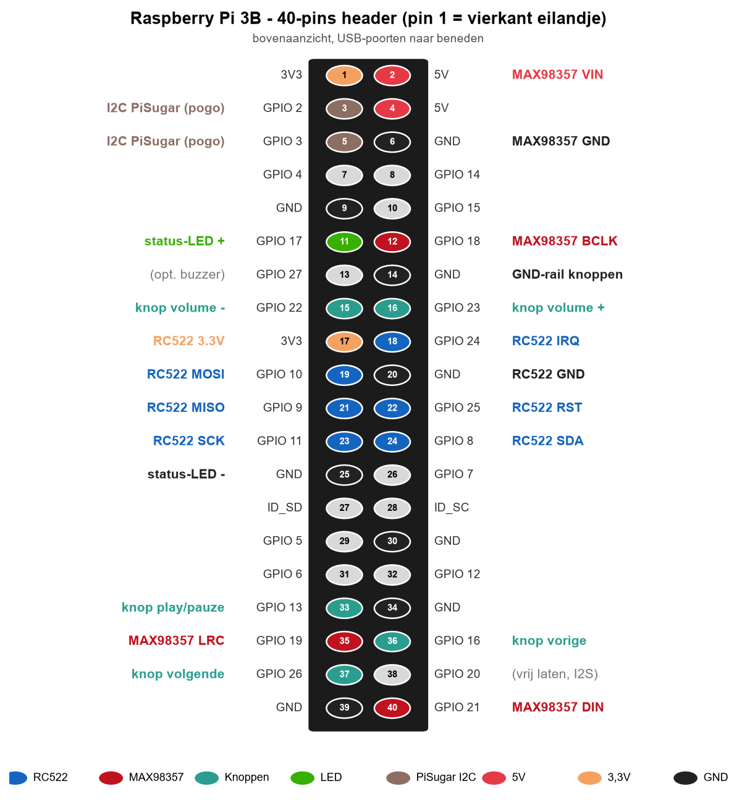

Waarom deze pinnen:

- GPIO 18, 19, 20 en 21 zijn van de versterker (I2S). Gebruik ze nergens anders voor.
- GPIO 2 en 3 (pin 3 en 5) zijn de I2C-pinnen waarmee de Pi de PiSugar uitleest. Die verbinding loopt via de veerpennen aan de onderkant: niet bedraden.
- De knoppen gebruiken de interne pull-up van de Pi: een knop verbindt de pin met GND.

## 4. Solderen en aansluiten

> Altijd de stroom eraf bij het aansluiten. De GPIO-pinnen en de RC522 kunnen maximaal 3,3 V hebben. Bouw alles eerst los op tafel en test het (hoofdstuk 8) voordat het in de behuizing gaat.

### 4.1 Voorbereiden

1. RC522: soldeer de draden direct aan de soldeergaten, of gebruik een haakse pinheader. In de compacte box zit de lezer vlak boven de speaker; rechte pinnen naar beneden zijn net te lang.
2. Versterker: de pinheader is al gesoldeerd. De speaker gaat in de schroefklem.
3. Speaker: soldeer twee draden van ongeveer 15 cm aan de soldeerlipjes. Bij één speaker maakt de polariteit niet uit.
4. Knoppen: deze hebben twee soldeerlippen. Knip van een Dupont-draadje de ene stekker af, strip het uiteinde en soldeer het aan lip 1. Soldeer onderweg een weerstand van 1 kΩ in deze draad (naar de Pi) en schuif krimpkous over de weerstand en over de lippen. Lip 2 gaat met een draadje naar de GND-rail. Soldeer bij voorkeur nadat de knop in het deksel zit, dan kan de moer er nog overheen.

### 4.2 RC522-lezer

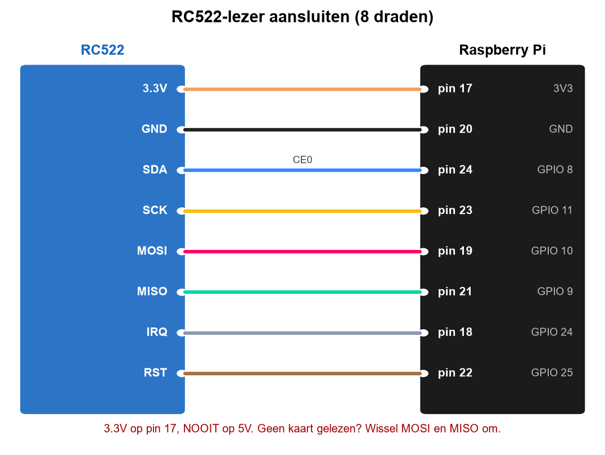

### 4.3 Versterker en speaker

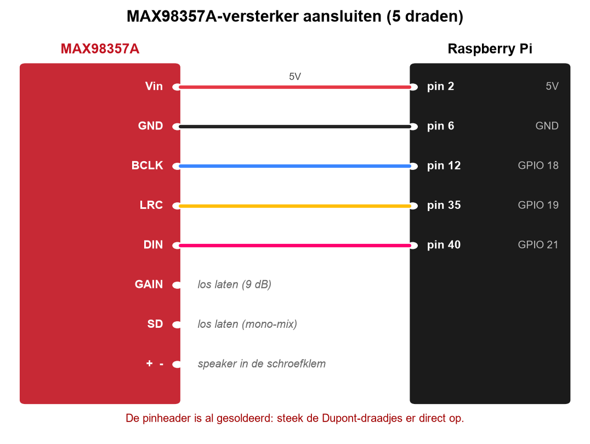

Laat GAIN los (9 dB) en SD los (links en rechts gemengd naar mono). Het maximale volume regelen we in de software.

### 4.4 Knoppen en GND-rail

De drukknop heeft twee soldeerlippen: ingedrukt zijn ze met elkaar verbonden. Welke lip je waarvoor gebruikt maakt niet uit.

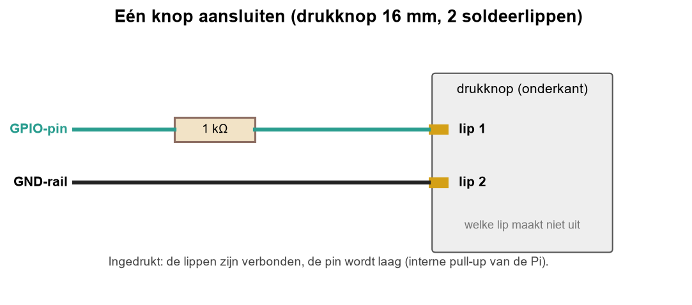

De Pi heeft te weinig GND-pinnen voor alle knoppen. Daarom komen alle lippen 2 samen op een strookje gaatjesprint, met één draad naar pin 14.

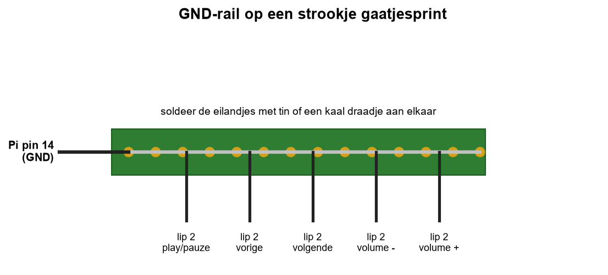

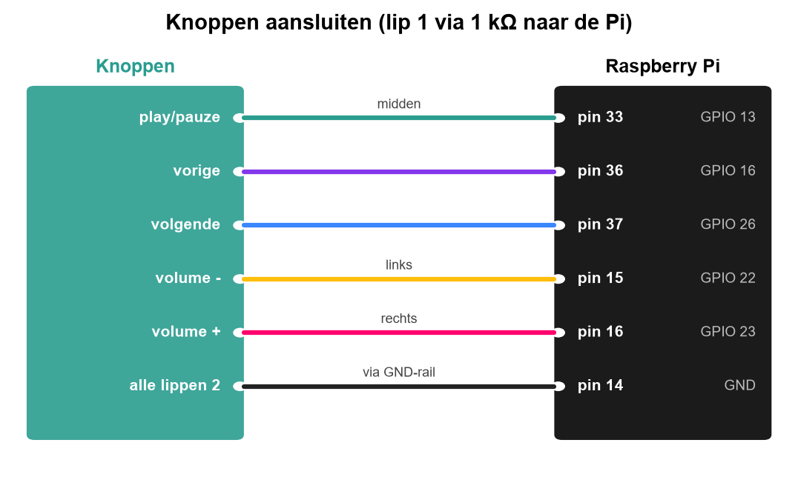

Volgorde op het deksel van links naar rechts: volume -, vorige, play/pauze, volgende, volume +. Op het deksel staat bij elke knop een symbool. Kleurvoorstel: groen voor play/pauze, blauw voor vorige en volgende, rood voor het volume.

### 4.4b Aan-knop

De zesde knop (midden op het deksel, tussen het NFC-vlak en play/pauze) gaat niet naar de Pi, maar met twee draadjes direct naar de aan/uit-knop van de PiSugar. Er zijn geen weerstanden of andere onderdelen nodig.

1. Zoek met de multimeter op doorpiepen, met de PiSugar uit, de twee pootjes van de PiSugar-knop die alleen piepen als je de knop indrukt.
2. Soldeer aan elk van die twee pootjes een dun draadje van ongeveer 20 cm en zet ze vast met een druppel hotglue tegen trekken.
3. Soldeer de andere uiteinden aan de twee lippen van de aan-knop en schuif er krimpkous over. Welke lip waar komt maakt niet uit.

Kleurvoorstel: wit, zodat hij duidelijk anders is dan de bedieningsknoppen.

### 4.5 Status-LED

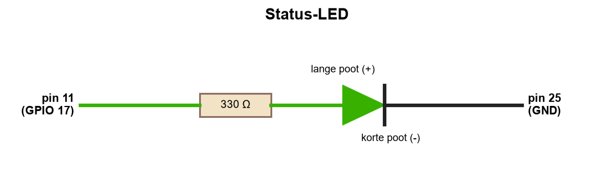

### 4.6 PiSugar-accu

De PiSugar wordt onder de Pi geschroefd. De veerpennen drukken op de koperen eilandjes aan de onderkant van de Pi (5 V, GND en I2C), dus er zijn geen draden nodig. Laden gaat alleen via de USB-C van de PiSugar: steek nooit tegelijk een voeding in de micro-USB van de Pi.

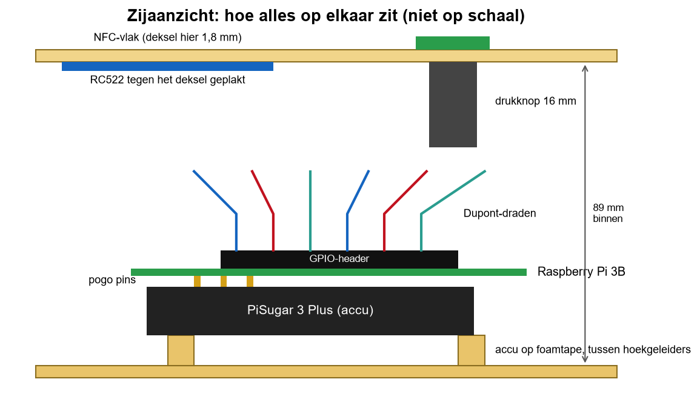

## 5. Behuizing printen

De behuizing is een parametrisch model, afgestemd op deze onderdelen. De bestanden staan in de map behuizing:

| Bestand | Wat |
|---|---|
| stl/onderbak.stl | Ovale bak 150 × 136 × 92 mm met wanden en bodem van 3 mm, met een rooster van ruitjes in de gebogen voorwand, een vlakke speakerplaat erachter, een kooi voor de Pi met PiSugar, schroefpalen, ventilatieruitjes in de achterwand, USB-C-doorvoer en het paperclip-gaatje voor aan/uit |
| stl/deksel.stl | Ovaal deksel 3 mm met schuine bovenrand, staat ondersteboven in het bestand. Bovenkant: pilvormige omtrek van het NFC-vlak, symbolen, 5 knopgaten van 16 mm met 2 vlakke kanten (tegen meedraaien) in een boog, een zesde knopgat voor de aan-knop, LED-gat en verzonken schroefgaten. Onderkant: rand van 3,5 mm die in de bak valt en het deksel uitlijnt, ruggen van 8 mm, verdikte strook van 4,5 mm bij de knoppenrij en een kamer voor de RC522 (daar is het deksel 2 mm) |
| stl/kooibeugel.stl | Beugel over de achterkant van de Pi; houdt de Pi met PiSugar in de kooi. Print met de vlakke kant op het bed |
| stl/drukstift.stl | Stiftje in het geleidebuisje achter het paperclip-gaatje; drukt op de aan/uit-knop van de PiSugar |
| behuizing.py | Het model zelf: pas maten aan en maak de STL's opnieuw met python behuizing.py. Het script controleert ook of alles nog past (Pi, speaker, knoppen, schroefpalen) |

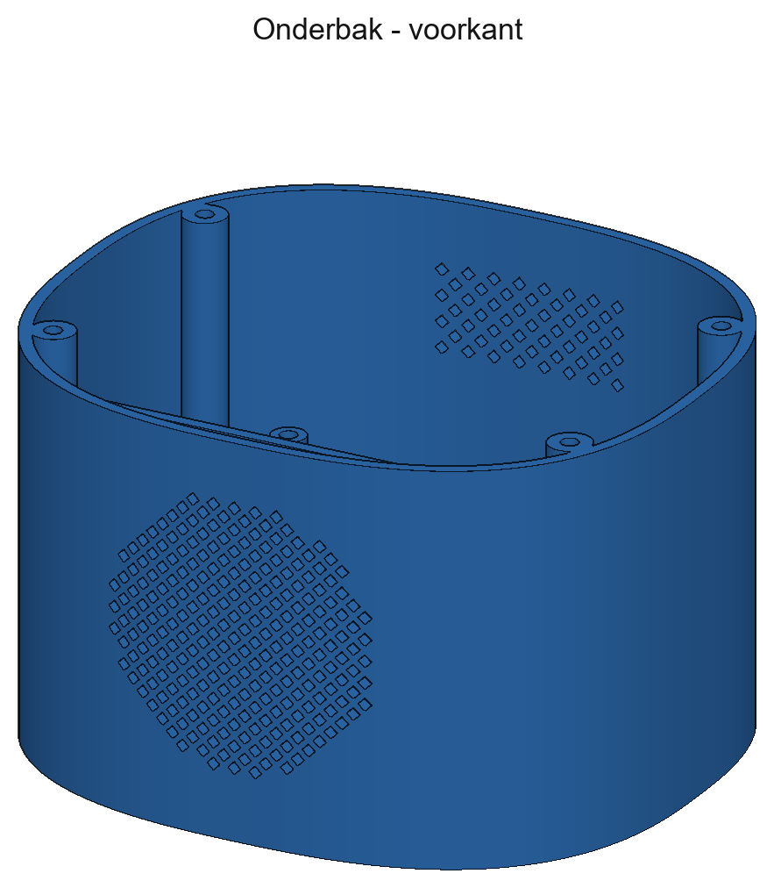

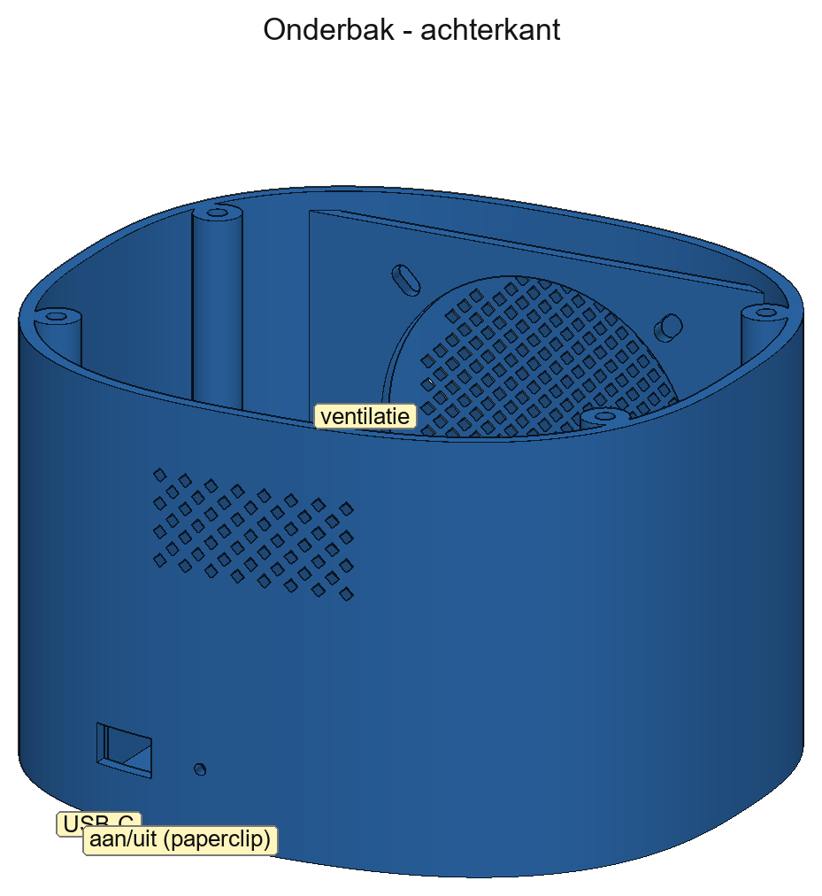

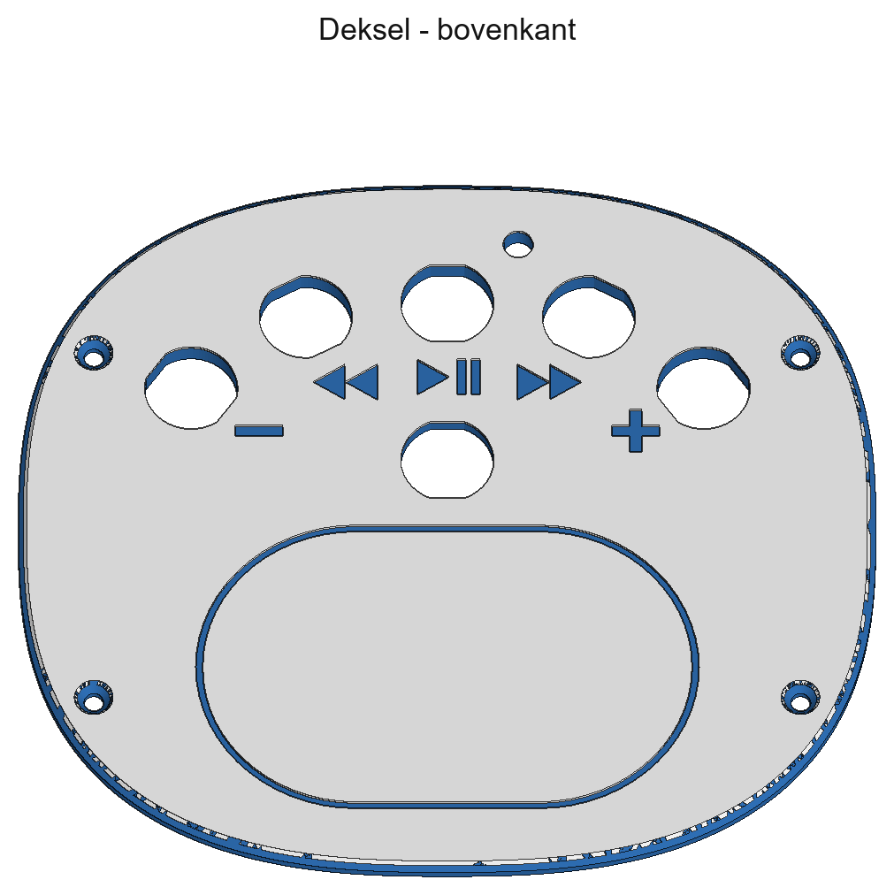

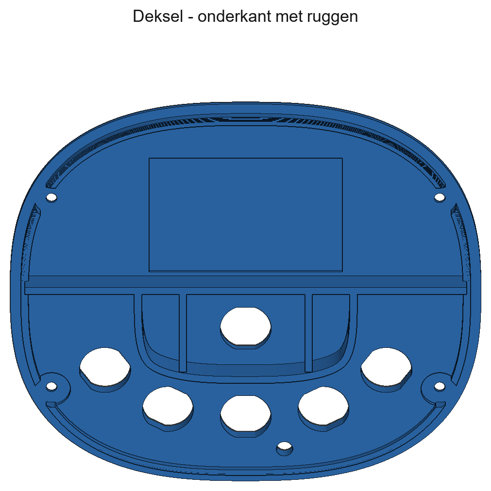

### 5.1 Eerst opmeten

Een paar maten kon ik niet vooraf controleren. Meet ze na ontvangst en pas ze zo nodig aan bovenin behuizing.py:

- Gatafstand van de speaker: gemeten 59 mm; de sleufgaten in de speakerplaat passen bij 57 tot 61 mm (SPK_HOLE_SPACING_MIN en _MAX).
- Positie van de USB-C-poort en de aan/uit-knop van de PiSugar (USBC_DX/USBC_Z en PUSH_DX/PUSH_Z, gemeten vanaf de SD-kaartrand van de Pi en vanaf de onderkant van de accu), hoe ver de knop buiten de Pi uitsteekt (PUSH_OUT) en de hoogte van de onderkant van de PiSugar-print boven de onderkant van de accu (PISUGAR_PCB_H, gemeten 13 mm). Voor de kooibeugel: de bovenkant van de USB-poorten (STACK_H, gemeten 34 mm) de bovenkant van de netwerkpoort (ETH_TOP, gemeten 31 mm) en de bovenkant van de Pi-print (PI_PCB_TOP, gemeten 16 mm; de schroefkopjes zijn 2 mm hoog), alle drie boven de onderkant van de accu. De lengte van het stiftje rekent het script hieruit uit. Het stiftje moet precies op de knop uitkomen en de knop net niet indrukken als je niets doet (PUSH_GAP).
- Maat van de RC522 (RC522_W en RC522_D) voor de kamer aan de onderkant van het deksel.
- De knoppen (gemeten): huls rond 15,8 mm (BTN_HOLE 16,2) met vlakke kanten op 14,8 mm (BTN_FLATS 15,1), moer 22 mm (BTN_NUT, hart-op-hart BTN_PITCH 25 mm), 19 mm diep onder het deksel tot de soldeerlippen (BTN_DEPTH). De schroefdraad is 9 mm, dus na de strook van 4,5 mm bij de knoppenrij blijft 4,5 mm over voor de moer (bij de aan-knop 6 mm); is de moer dikker, verlaag dan RIB_PAD. Het script controleert dat de knoppen vrij blijven van de kooibeugel en de speaker.

Wil je de vorm ronder of hoekiger? Verander SHAPE_N (2 = ellips, 3 = meer rechthoekig) en draai het script; het meldt het als iets niet meer past.

Tip: print eerst alleen het deksel. Dan zie je meteen of de knoppen en de RC522 passen, voordat je de grotere onderbak print.

### 5.2 Printinstellingen

- Materiaal: PETG (sterker en beter tegen warmte, fijn bij het laden) of PLA.
- 0,2 mm laaghoogte, 3 perimeters, 20 % gyroid-infill.
- Onderbak: open kant naar boven, geen support nodig.
- Deksel: zoals het in het STL-bestand staat, dus ondersteboven met de bovenkant op het bed en de ruggen omhoog. Geen support nodig. Print het met 100 % infill (rectilinear): de stijfheid komt van volle ruggen en een volle strook. Zet de eerste laag op 0,2 mm en Bottom fill pattern op Monotonic; brim is niet nodig. De printplaat bepaalt de afwerking van de bovenkant: getextureerd geeft mat en korrelig, glad geeft glad. Maak de plaat goed schoon; bij PETG op gladde PEI lijm als scheidingslaag gebruiken.
- Twee kleuren met één filamentwissel: voeg in PrusaSlicer in het voorbeeld met de schuif een kleurwissel toe op de laag van 0,80 mm (de vierde laag, bij 0,2 mm laaghoogte). Die laag is de eerste in de nieuwe kleur; de drie lagen tot en met 0,60 mm blijven in de eerste kleur. Controleer dat in het voorbeeld, en laat bij de wissel doorspoelen tot de nieuwe kleur schoon uit de nozzle komt. De eerste kleur wordt de zichtlaag (ongeveer 12 g); de tweede kleur vult de symbolen en de NFC-omtrek en vormt de rest van het deksel (ongeveer 65 g).
- Drukstift: met de kraag op het bed.
- Geen metallic- of carbon-filament: dat stoort de NFC-lezer.

### 5.3 Draadinzetstukken

Druk de inzetstukken met de soldeerbout (ongeveer 220 °C) recht in de gaten: 4× M3 in de hoekpalen en 2× M3 in de paaltjes naast de kooi. Laat ze afkoelen voordat je er iets op schroeft.

## 6. Assemblage

### Stap 1 - Draadinzetstukken

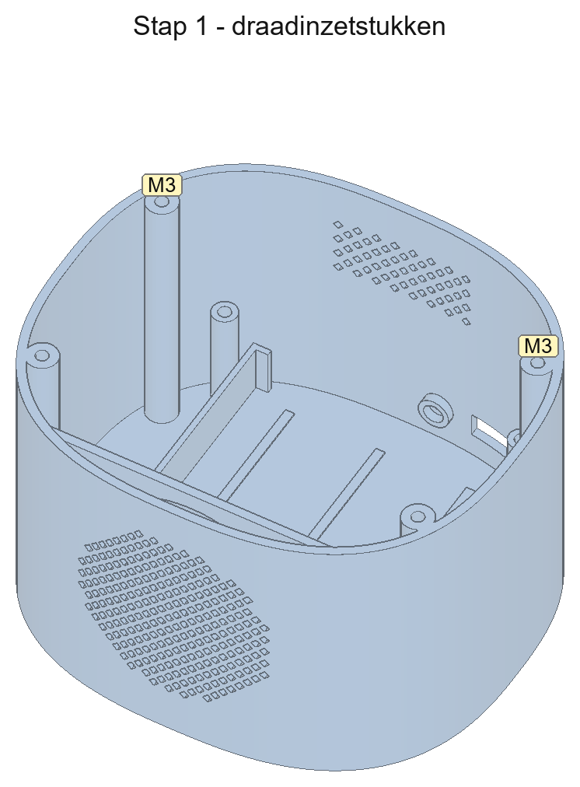

Zet de M3-inzetstukken in de vier hoekpalen en de twee paaltjes links en rechts naast de kooi.

### Stap 2 - PiSugar en Pi

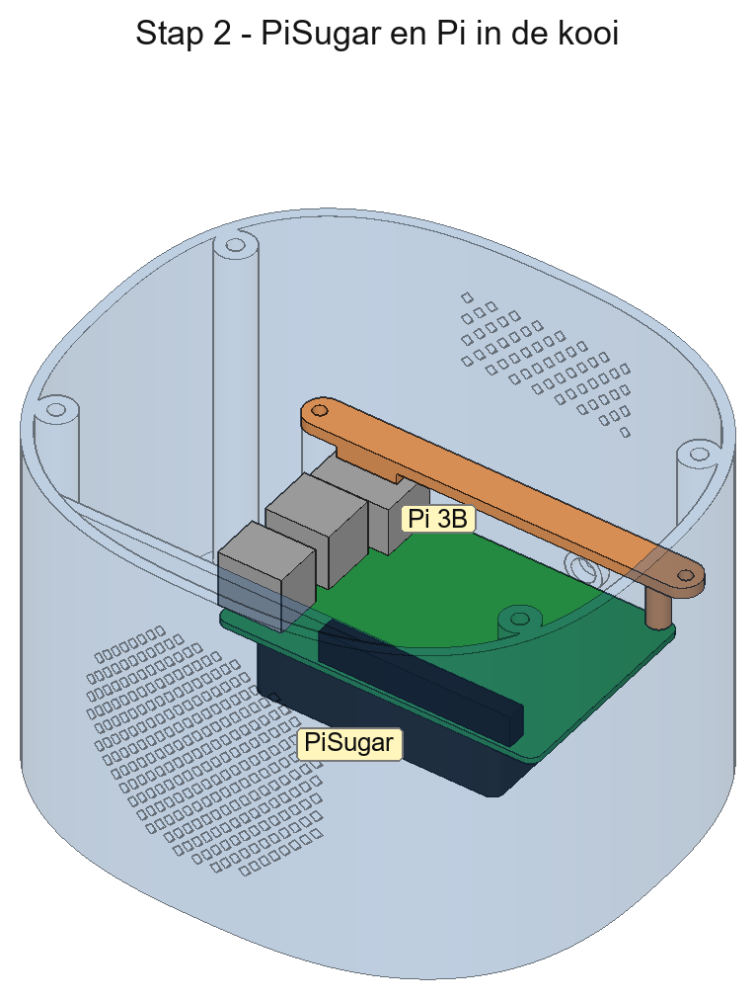

1. Schroef de PiSugar onder de Pi met de meegeleverde busjes. Controleer dat de veerpennen op de eilandjes drukken.
2. Zet de microSD-kaart (met de software, hoofdstuk 7) in de Pi.
3. De accu zit voor de schroefgaten, dus het pakket wordt niet in de bak geschroefd maar opgesloten. Zet het in de kooi achter in de bak, met de USB-C-poort en de aan/uit-knop naar de achterwand (de achterkant van de kooi is open). De SD-kaart valt in de uitsparing in de rechterwand.
4. Leg de kooibeugel over de achterkant van de Pi: het blokje rust op de netwerkpoort, het nokje op het schroefkopje bij de SD-kaart. Schroef hem vast met 2× M3 × 6 mm. Het pakket mag daarna niet meer kunnen bewegen.

### Stap 3 - Speaker en versterker

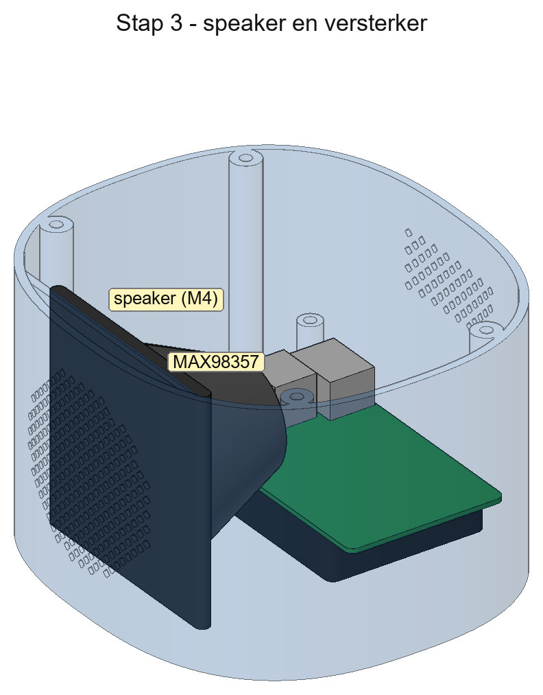

1. Achter de gebogen voorwand zit een vlakke speakerplaat. Zet de speaker van achteren tegen die plaat en schroef hem vast met 4× M4. De moeren komen in de smalle ruimte tussen voorwand en plaat: houd ze vast met een pincet of zet ze met een druppel lijm vast in de sleufgaten. Een ring tochtstrip of foam tussen speaker en plaat voorkomt rammelen.
2. Plak de versterker met dubbelzijdig tape op de bodem, links naast de Pi. Sluit de speaker aan op de schroefklem en steek de vijf draadjes naar de Pi erop.
3. Plak de GND-rail tegen een zijwand. Leid de draden netjes langs de wand.

### Stap 4 - Knoppen, LED en RC522 in het deksel

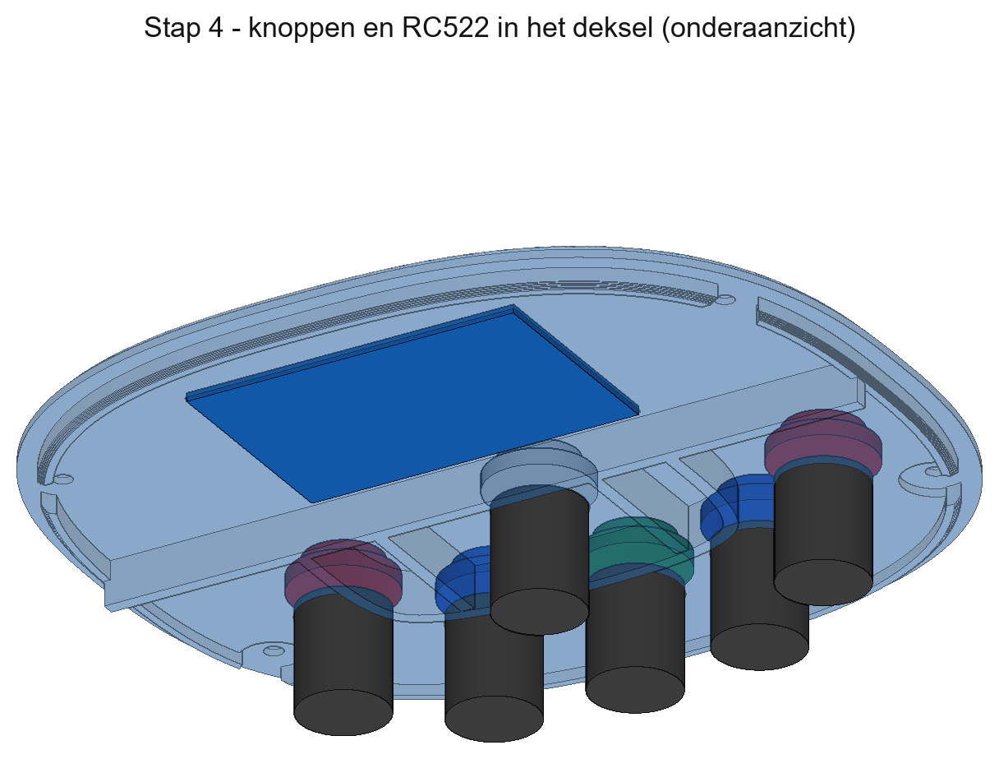

1. Steek de zes knoppen van bovenaf in de gaten (de witte aan-knop in het midden); de vlakke kanten van de huls vallen in de vlakke kanten van het gat, zodat de knop niet kan meedraaien. Draai de moeren aan de onderkant vast; achter de knoppen is ruimte voor een sleutel. Het deksel is daar 4,5 mm dik, bij de aan-knop 3 mm.
2. Druk de LED in het kleine gat (eventueel met een druppel lijm).
3. Leg de RC522 met de antenne tegen het deksel in de kamer aan de onderkant, onder het NFC-vlak, en zet hem vast met dubbelzijdig tape of een paar druppels hotglue.
4. Verbind de lippen 2 van de vijf bedieningsknoppen met de GND-rail en sluit alles aan volgens hoofdstuk 4. De aan-knop gaat met zijn twee draadjes naar de PiSugar (hoofdstuk 4.4b), niet naar de Pi of de GND-rail.

### Stap 5 - Sluiten

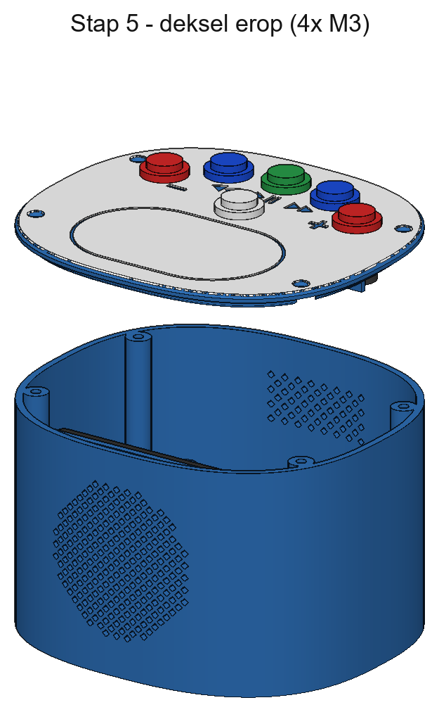

1. Leg het stiftje in het geleidebuisje aan de binnenkant van de achterwand, met het platte kopje naar de PiSugar. Het stiftje is dikker dan het gaatje en kan er dus niet uit. Controleer met een paperclip dat je de box aan kunt zetten.
2. Steek de USB-C-kabel door de opening tot in de poort van de PiSugar. De poort zit ongeveer 12 mm achter de buitenkant; een kabel met een dikke of lange stekkerkop (breder dan 14 × 8,5 mm) past niet.
3. Leg het deksel erop: de rand aan de onderkant valt in de bak en lijnt het deksel uit. Schroef het vast met 4× M3 verzonken.

## 7. Software installeren

### 7.1 SD-kaart voorbereiden

1. Installeer de Raspberry Pi Imager.
2. Kies bij het OS: Raspberry Pi OS (other) → Raspberry Pi OS (Legacy, 32-bit) Lite.
3. Stel in: hostname muziekbox, een gebruiker met wachtwoord, jullie wifi, land NL en SSH aan met wachtwoord.
4. Schrijf de kaart, zet hem in de Pi en zet de box aan. Wacht ongeveer twee minuten.

### 7.2 Phoniebox installeren vanaf onze GitHub

Log in vanaf de pc met ssh gebruiker@muziekbox.local. Start eerst tmux, zodat de installatie doorloopt als de verbinding wegvalt:

```
sudo apt install -y tmux && tmux
cd
U=https://raw.githubusercontent.com/WNijhof/RPi-Jukebox-RFID/eigen/main/installation/install-jukebox.sh
GIT_USER='WNijhof' GIT_BRANCH='eigen/main' bash <(wget -qO- $U)
```

| Vraag van het script | Antwoord |
|---|---|
| Start the installation? | Y |
| Disable IPv6? | N (anders vindt de Spotify-app de box niet) |
| Set a static IP? | N (zet het adres liever vast in de router) |
| Autohotspot? | N |
| Disable Bluetooth? | Y |
| Disable Pi's on-chip audio? | Y (we gebruiken de I2S-versterker) |
| Setup a rfid reader? | Y, kies RC522 SPI en laat de pinnen op de standaardwaarden |
| Install Samba? | Y |
| Install the Web App? | Y |
| Kiosk Mode? | N |

De webpagina wordt niet op de Pi gebouwd: GitHub bouwt hem bij elke wijziging vooraf en het script downloadt hem. Alleen als die download ontbreekt bouwt de Pi hem zelf, en dan duurt de installatie een half uur langer. Herstart na afloop met sudo reboot.

### 7.3 Versterker inschakelen

```
cd ~/RPi-Jukebox-RFID/installation/components
./setup_hifiberry.sh enable hifiberry-dac
sudo reboot
```

Test daarna met paplay /usr/share/sounds/alsa/Front_Center.wav en draai ./setup_configure_audio.sh in dezelfde map.

Equalizer: beantwoord de vraag over de equalizer in dat script met Y. Vervang daarna in ~/.config/pulse/default.pa de waarden achter control= door -18,-10,-2,-1,-4,-4,-4,-4,-1,-2 (31 Hz tot 16 kHz, in dB) en zet de regel set-default-sink onder de regel met module-ladspa-sink. De standaardwaarden tillen de lage tonen te ver op voor deze kleine speaker. Herstart met sudo reboot en beoordeel het geluid pas als de speaker in de behuizing zit. Daarna regel je de equalizer op de webpagina bij Settings → Audio: kies een preset of zet de schuiven zelf; Standard zet deze waarden terug. De muziek hapert kort bij elke wijziging.

### 7.4 PiSugar-software

Installeer de PiSugar Power Manager volgens de actuele instructie op github.com/PiSugar/pisugar-power-manager-rs en kies model PiSugar 3. Zet I2C aan via sudo raspi-config als het script dat niet doet. In de PiSugar-webpagina (http://muziekbox.local:8421) stel je in:

- anti-mistouch uit, zodat één korte druk op de aan-knop de box aanzet;
- soft poweroff aan, met als afsluitscript een leeg commando (true): lang drukken op de aan-knop of de PiSugar-knop sluit de box dan niet af. Wil je later wel uitzetten met lang drukken, zet hier dan sudo shutdown --poweroff 0;
- veilig afsluiten bij ongeveer 5 % batterij;
- controleer dat de dienst pisugar-poweroff aan staat (systemctl status pisugar-poweroff): die haalt na elk afsluiten de stroom eraf. Test het: sluit af en kijk of de lampjes van de PiSugar uitgaan.

## 8. Configureren en testen

### 8.1 Knoppen en LED

```
systemctl --user stop jukebox-daemon
cp ~/RPi-Jukebox-RFID/eigen/gpio.yaml ~/RPi-Jukebox-RFID/shared/settings/gpio.yaml
nano ~/RPi-Jukebox-RFID/shared/settings/jukebox.yaml
```

Zet in jukebox.yaml:

- bij gpioz: enable: true;
- bij pulse: zet # voor startup_volume, zodat de box start op het laatst gebruikte volume, en soft_max_volume: 80;
- bij jingle: volume: 60 (opstart-, afsluit- en bijna-leeg-geluid);
- bij timers → idle_shutdown: timeout_sec: 1800. De box gaat dan na 30 minuten zonder muziek vanzelf uit (minimaal 60 seconden; 0 = nooit).

Start daarna weer met systemctl --user start jukebox-daemon.

Knoppen kun je later per stuk uitzetten op de webpagina, bij Settings → Buttons. Een uitgezette knop doet niets meer en blijft ook na opnieuw opstarten uit. De aan-knop werkt altijd, want die zit rechtstreeks op de PiSugar.

Zet eenmalig de automatische updates aan:

```
~/RPi-Jukebox-RFID/installation/components/update_jukebox.sh install
```

De box kijkt daarna elke 10 minuten dat hij aanstaat of er een nieuwe release op GitHub staat. Hij werkt zichzelf bij zodra er geen muziek speelt. Start de box daarna niet goed, dan gaat hij vanzelf terug naar de oude versie. Een update uitbrengen doe je op GitHub met een gewone release (geen pre-release) op een commit van eigen/main.

### 8.2 Testen

Volg de log met tail -f ~/RPi-Jukebox-RFID/shared/logs/app.log, of open http://muziekbox.local/logs.

| Test | Verwacht |
|---|---|
| Webpagina http://muziekbox.local | Phoniebox, met de actie Spotify bij Cards |
| Status-LED | Gaat aan als de box klaar is |
| Lader erin | Status-LED knippert, en brandt continu zodra de accu vol is. De box blijft aan |
| Kaart of sticker tegen het NFC-vlak | Kaartnummer in de log en in de webpagina |
| Elke knop | Regel in de log (toggle, next_song, change_volume) |
| Aan-knop kort indrukken (box uit) | De box gaat aan; ook met de paperclip in het gaatje |
| Aan-knop lang indrukken (box aan) | Er gebeurt niets |
| Afsluiten via de webpagina | De box sluit af en daarna gaan de lampjes van de PiSugar uit |
| Instellingen → Status | Batterijpercentage, en charging als de lader erin zit |

## 9. Spotify

### 9.1 Wat je nodig hebt

- Spotify Premium voor het account van de box (een account binnen Premium Family is prima). Gebruik een gewoon familie-account, geen Spotify Kids-account.
- Gedeelde playlists: maak ze vanaf je eigen account en maak ze gezamenlijk (Samenwerken). Laat het box-account de playlists volgen. Een kaart speelt altijd de actuele versie.

### 9.2 Spotify-app aanmaken (eenmalig)

1. Ga naar developer.spotify.com/dashboard en klik op Create app.
2. Naam Muziekbox, Redirect URI precies http://127.0.0.1:8888/callback, vink Web API aan en sla op.
3. Kopieer de Client ID. Een Client Secret is niet nodig.
4. Heb je de app met een ander account gemaakt? Voeg het box-account toe onder User Management.
5. Maak op dezelfde site een Soloist API-sleutel aan (Spotify Soloist API Key). Hiervoor is een Premium-account nodig. Houd de sleutel geheim.

### 9.3 Koppelen op de box

```
cd ~/RPi-Jukebox-RFID/installation/components
./setup_spotify.sh
systemctl --user restart jukebox-daemon
```

Het script installeert de Spotify-luidspreker (Spotify Soloist, de officiële luidspreker-software van Spotify) en vraagt om de API-sleutel. Je ziet niets tijdens het plakken; de sleutel komt in een bestand dat alleen de box kan lezen. Soloist werkt zichzelf dagelijks bij, want elke versie werkt maar 90 dagen. Daarna vraagt het script je om in de Spotify-app op je telefoon, ingelogd als het box-account, eenmalig de luidspreker Muziekbox te kiezen. Daarna plak je de Client ID, log je in via de link en plak je het adres van de foutpagina van 127.0.0.1 terug. Die foutpagina is de bedoeling.

### 9.4 Kaart koppelen

Open http://muziekbox.local → Cards → nieuwe kaart → houd de kaart tegen de box → kies Spotify → kies een playlist of plak een Spotify-link → geef de kaart een naam → opslaan.

| Situatie | Wat er gebeurt |
|---|---|
| Kaart scannen | De playlist start. Was hij eerder halverwege, dan gaat hij daar verder |
| Dezelfde kaart nog eens | Gaat verder als hij op pauze stond |
| Andere kaart | De positie van de vorige wordt onthouden, de nieuwe start |
| Knoppen | Bedienen Spotify; het volume blijft onder het maximum |
| Muziek naar je telefoon halen | De box laat Spotify los |

## 10. Accu en veiligheid

- Speelduur: ongeveer 5 tot 6 uur per lading (schatting, harder volume is korter).
- Aanzetten: kort op de witte aan-knop drukken (of met een paperclip in het gaatje aan de achterkant). Uitzetten: via de webpagina, of de box gaat vanzelf uit.
- Na 30 minuten zonder muziek gaat de box vanzelf uit (instelbaar, hoofdstuk 8.1).
- Onder 10 % kan de box een waarschuwing geven (in te stellen bij battmon in jukebox.yaml), onder 3 % sluit hij netjes af.
- Laad de eerste keren onder toezicht en voel of de box niet warm wordt. Niet laden onder een deken of in de felle zon.
- Een opgezwollen of beschadigde accu niet meer gebruiken: inleveren bij een inzamelpunt.

## 11. Problemen oplossen

| Probleem | Oplossing |
|---|---|
| Kaart wordt niet gelezen | 3,3 V en GND controleren, MOSI en MISO omwisselen. Is het een Mifare-kaart of -sticker (geen NTAG)? |
| Geen geluid | /boot/firmware/config.txt moet dtoverlay=hifiberry-dac bevatten. Controleer de draden naar pin 12, 35 en 40 |
| Knop doet niets | Staat de knop aan op de webpagina (Settings → Buttons)? Staat gpioz op enable: true? Zit de weerstand in de draad naar de Pi? |
| Knop reageert dubbel | Voeg bounce_time: 0.1 toe bij die knop in gpio.yaml |
| Paperclip zet de box niet aan | Het stiftje raakt de PiSugar-knop niet: pas PUSH_DX, PUSH_Z, PUSH_OUT of PUSH_GAP aan in behuizing.py en print alleen het stiftje (of de onderbak) opnieuw |
| Box gaat te snel of nooit vanzelf uit | Pas timers → idle_shutdown → timeout_sec aan in jukebox.yaml |
| Spotify: device not found | Draait Soloist? systemctl --user status soloist. Kies de box nog eens als luidspreker in de Spotify-app |
| Spotify werkt opeens niet meer | De Soloist-versie is verlopen. ./setup_spotify.sh update haalt een nieuwe op |
| Spotify is not authorized | ./setup_spotify.sh auth opnieuw uitvoeren |
| Update komt niet door | shared/logs/update.log (ook via http://muziekbox.local/logs) laat zien waarom. De box moet aanstaan, mag geen muziek spelen en de webpagina van die commit moet klaar zijn op GitHub |
| Geen batterijniveau | Draait pisugar-server? Staat I2C aan? |
| Box start steeds opnieuw op | Accu leeg of lader te zwak: gebruik de 3 A-lader |
